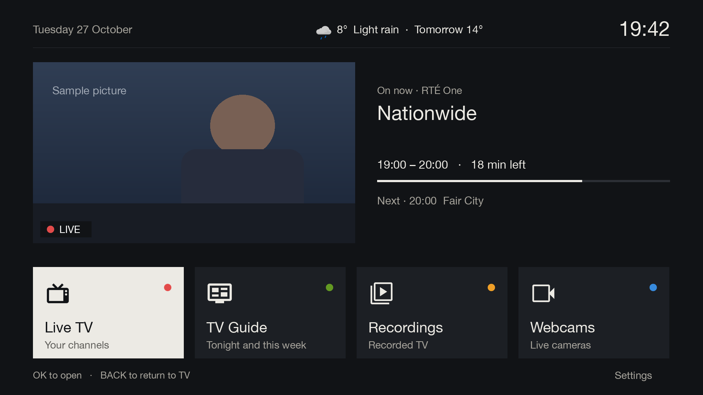

# Gullion TV

A simpler, calmer way to use an Enigma2 Linux-based satellite and terrestrial box. Gullion TV puts a large-text home screen in front of the popular [OpenATV](https://opena.tv) Engima2 distribution, so someone who just wants to watch TV never meets the box's technical menus.



## Why it exists

Gullion TV was made to be simple and user friendly, though it suits anyone who finds set-top box menus hard going.

| Goal | Description |
| ---- | ----------- |
| A simpler interface | Home screen with four choices for the most frequently used features |
| Single unified channel list | Just like in the good old days, view all broadcast channels in a single list |
| Integrate webcams | Permit the easy viewing of local or community webcam feeds |
| Restricted default menus | PIN-protected access to stock menus on the image, preventing accidental 'breaking' of features |

### A simpler interface

Modern smart TVs and streaming services can have an overwhelming list of apps, features and ads, making it hard to 'just see the news' on old-style linear broadcast TV services. Gullion TV makes it easy to access four regularly used common features as well as a prominent preview of the last viewed channel and it's now/next EPG info. The home screen also displays the date, the time, and a weather forecast, if configured.

The text is purposefully large and high-contrast, and the wording is in plain-English, with no jargon, e.g. does not refer to 'EPG' or 'bouquets'. 

| Feature | Shortcut | Description |
| ------- | -------- | ----------- |
| Live TV | RED button | Show broadcast channels setup to any tuners in the box |
| TV Guide | GREEN button | View the EPG for any bouquets configured on the box |
| Recordings | YELLOW button | List any broadcasts recorded on the box, also Plex TV or Movie libraries, if configured |
| Webcams | BLUE button | View any webcam or other livestreams setup |


### Single unified channel list

Television sets pre 'smart' TVs typically permitted the scan for any local terrestrial or satellite signals, and allowed users to order the channels received according to their own personal preference. Modern TVs are configured to a region when setup, meaning that any channel ordering is fixed to whatever that region expects. While this works for the majority of users, anyone attempting to receive channels from more than a single jurisdiction will have a random jumble of channels for any broadcasts received outside of their 'region'.  

### Integrate webcams

This feature allows the integration of some local or publically accessible web cam streams. These are provided via editing a configuration file locally on the box, and supports locating streams from [mcn.live](https://mcn.live), [churchservices.tv](https://www.churchservices.tv) or any camera link. 

### Restricted default menu

Enigma2 boxes are powerful and have an extensive range of features, the majority of which are not required in daily use, but it is easy to stumble into an advanced feature when carrying out basic actions. GullionTV prevents access to these advanced features via an administrator set PIN code, which stops unwanted or unncessary tinkering with the advanced features of the box.

## Status

**This is early beta software with limited testing on real set-top boxes.** 

It has been tried on:

| Box | Image | Python | Notes |
|---|---|---|---|
| GigaBlue UHD Quad 4K | OpenATV 7.6 | 3.13 | MetrixHD skin at Full HD (1920x1080); Astra 2 through a Unicable LNB |
| Formuler F1 | OpenATV 6.4 | 2.7 | DVB-S2 plus a DVB-T2/C tuner, on a 1080p TV |

The GigaBlue is the main test box and has had every feature to date. The Formuler hasn't been tried with the
recent changes (the banner layout, Sound and subtitles, REC and STOP, and the Recordings screen), and the
Recordings screen hasn't been tried on either box yet. The offline checks in `tools/` run the plugin against
stand-ins for enigma2, and the screenshots in this README and the documentation are renders from those stand-ins, not captures from a
box. Expect rough edges on other boxes, images and skins.

Most of the design and code were written with [Claude](https://www.anthropic.com/claude), Anthropic's AI
assistant, working from the owner's requirements and review.

## To do

- **Series link.** "Record series" in the TV Guide, for every upcoming episode of a programme on one channel
  (Coronation Street on ITV1, say). enigma2 has no series link of its own, so this would create a rule for the
  AutoTimer plugin (installed from the OpenATV feeds if it isn't already): the exact title only, one channel only
  so +1 and regional versions aren't recorded too, and episodes already recorded or set to record skipped.
  Freesat descriptions are sometimes missing or the same every week, so spotting repeats won't be perfect.
  Recordings would list the series being recorded, with a way to stop one. Needs checking on a box for the
  AutoTimer version.
- Opening a film or programme from Plex and playing it.
- The box's recording player in the Gullion TV style.

## Documentation

The [documentation](docs/README.md) shows each part of Gullion TV with pictures, and how to set it up:

| Using it | Setting it up |
|---|---|
| [Home](docs/features/home.md) | [Install](docs/setup/install.md) |
| [Live TV](docs/features/live-tv.md): the banner, What's on, Sound and subtitles, recording | [Tech Support](docs/setup/tech-support.md): the PIN, settings, weather |
| [TV Guide](docs/features/tv-guide.md) | [Webcams list](docs/setup/webcams-config.md) |
| [Recordings](docs/features/recordings.md) | [Plex setup](docs/setup/plex-setup.md) |
| [Webcams](docs/features/webcams.md) | [Development](docs/development.md): code layout, checks, screenshots |
| [Plex](docs/features/plex.md) | |

## Quick start

You need an enigma2 box on OpenATV 6.4 or 7.x, with SSH access as root. From a computer on the same network:

```sh
BOX=192.168.1.50 scripts/deploy.sh
```

This copies Gullion TV to the box and restarts enigma2. Then press MENU. The first time Settings is opened, it asks
for a Tech Support PIN to be chosen. See [Install](docs/setup/install.md) for the details and the optional extras
(a recording drive, ffmpeg, Plex).

## Licence

Gullion TV is free software under the [GNU General Public License, version 2](LICENSE), the same licence as
enigma2. Weather forecasts are [Met Éireann](https://www.met.ie) open data, with
[Open-Meteo](https://open-meteo.com) as a backup, both under CC BY 4.0. The weather icons are
[Yr's](https://github.com/metno/weathericons), under the MIT licence, whose notice is in `images/weather/LICENSE`.
All three are credited on the settings screen. It isn't affiliated with Plex, Freesat, Saorview, mcn.live or churchservices.tv; their names appear only
to describe what Gullion TV works with.
