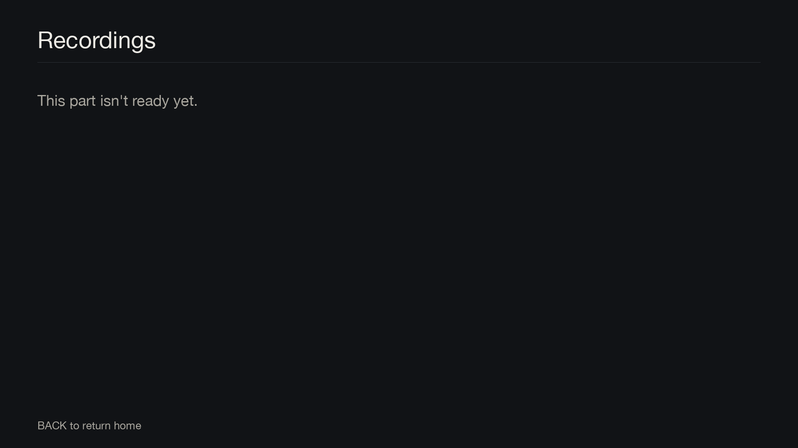

# Development

[Documentation](README.md) › Development

## Layout

```
docs/                    these pages; images/ holds the rendered screenshots
plugin/GullionTV/        the enigma2 plugin (copied to /usr/lib/enigma2/python/Plugins/Extensions/GullionTV)
  plugin.py              plugin descriptors: session-start hook and the Plugins menu entry
  hook.py                redirects MENU, INFO, OK, YELLOW and the guide keys to Gullion TV's screens
  lock.py                asks for the Tech Support PIN before any stock settings or plugin screen opens
  settings.py            the box settings: on/off, channel banner, Tech Support PIN
  setup.py               Tech Support settings screen
  home.py                the Home screen
  watchagain.py          experimental Media screen preserved by the experimental-media-design tag
  weather/
    forecast.py          the weather line: Met Éireann's forecast, with Open-Meteo as a backup
  theme.py               shared colours
  images/                weather/ holds the Yr weather icons;
                         icons/ holds Material Symbols and Material Design Icons, including the red
                         record mark in the guide (see icons/NOTICE)
  ui/                    shared building blocks
    tiles.py             picture panels for Media and the Plex views
    popups.py            themed choice and programme-details pop-ups
    pin.py               PIN prompts, including choosing the Tech Support PIN on first use
    placeholder.py       stand-in screen for parts still to come
    background.py        runs network and disk work off the screen thread
    scale.py             fits the 1920x1080 layouts to the skin's size
    icons.py             picks each Material icon at the size nearest the skin's
    live.py              the red-dot LIVE marker on Home's preview and the webcam player
  tv/                    live TV
    guide.py             the TV Guide
    epg.py               channel lists, programme data, record timers and channel switching
    picon.py             finds the picon (channel logo) file for any channel
    infobar.py           the channel banner, number entry and volume pop-ups, swapped in at start-up
    mute.py              persistent global mute alert skin, swapped in before VolumeControl starts
    converter.py         GullionServiceInfo skin converter: Number, Name, Remaining, Icon:N
    renderer.py          GullionIcon skin renderer, which draws the banner's icons
    serviceinfo.py       HD, delivery, access codes, signal details and channel numbers
    nowinfo.py           the What's on panel (INFO)
    soundsubs.py         the Sound and subtitles pop-up (YELLOW)
  recordings/            the box's own recordings
    screen.py            the Recordings screen: the list, and the chosen recording large beside it
    store.py             reads recordings, sizes and resume points, sorts, checks the drive, deletes to the recycle bin
    thumbnails.py        a 768x432 frame from each recording, via ffmpeg, saved as <recording>.ts.jpg
  plex/
    client.py            a small Plex client (Python 2.7): linking, Home users, servers, libraries, artwork
    setup.py             Tech Support's Plex setup screens
    library.py           the Films and TV programmes poster views
  webcams/
    screens.py           the Webcams grid and full-screen player
    config.py            reads webcams.yaml (PyYAML if the box has it, otherwise a small built-in reader)
    sources.py           streams, pictures and live status for mcn.live, churchservices.tv, streams and M3U lists
config/webcams.yaml      sample webcams list, installed on the box the first time you deploy
config/images/           webcam tile pictures, copied to the box on every deploy
scripts/deploy.sh        copy to the box, restart enigma2, save a screenshot
tools/check.py           offline check against stub enigma2 modules, and the docs' links and pictures
tools/e2stubs.py         stand-ins for the enigma2 modules, used by check.py and preview.py
tools/sample_*.py        made-up channels, Plex replies, recordings and webcam pages for the checks and renders
tools/make_images.py     regenerate images/ from the theme colours, and icons/ from the Material Symbols font (needs Pillow)
tools/fetch_weather_icons.py  fetch and scale the Yr weather icons into images/weather/ (needs Pillow)
tools/preview.py         render the sample screenshots in docs/images/ (needs Pillow)
```

## Offline checks

```sh
python3 tools/check.py
```

This imports Gullion TV against stand-ins for the enigma2 modules (`tools/e2stubs.py`) and drives every screen with
sample data: Home, the guide, the banner's converter, Recordings, Watch again, Webcams, Plex, the PIN and the lock.
It also parses every skin, checks each one fits 1280×720, 720×576 and 3840×2160 skins once scaled, and checks
that Python 2 can read every file. It needs only Python 3, with no extra packages.

It checks these docs too: every picture a page shows must exist, every rendered screenshot must be shown on some
page, and every page must be linked from the [index](README.md).

## Screenshots

```sh
pip install pillow
python3 tools/preview.py
```

This renders the screens into `docs/images/` from their real skin layouts and screen code, with the sample data
in `tools/sample_*.py`. Fonts and the TV picture are approximations of what the box draws. When a screen changes,
render again and look at its pictures before committing.

A new picture has to be shown on a page, or `tools/check.py` fails. The stand-in screen used for parts still to
come is shown here:



Captures from a real box (`scripts/deploy.sh` saves one into `screenshots/` after every deploy) can go in
`docs/images/box/`, marked as captures in their captions.

## Icons

`tools/make_images.py` makes the icons in `plugin/GullionTV/images/icons/` at a few sizes each, from the Material
Symbols font, Material Design Icons and Open Sans (for the REC pill). Point it at local copies of each:

```sh
MATERIAL=/path/to/symbols MDI=/path/to/mdi REC_FONT=/path/to/OpenSans.ttf python3 tools/make_images.py
```

`tools/fetch_weather_icons.py` fetches and
scales the Yr weather icons. Both need Pillow. Their licences are in the icons and weather folders.

## Trying it on a box

```sh
BOX=192.168.1.50 scripts/deploy.sh
```

See [Install](setup/install.md).
