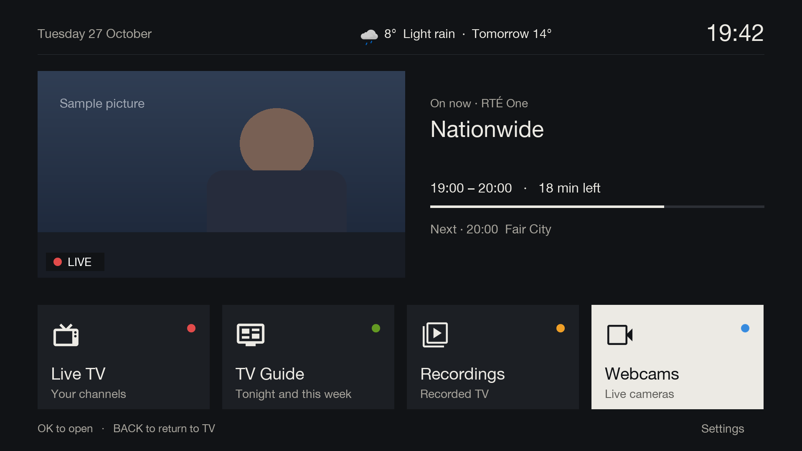
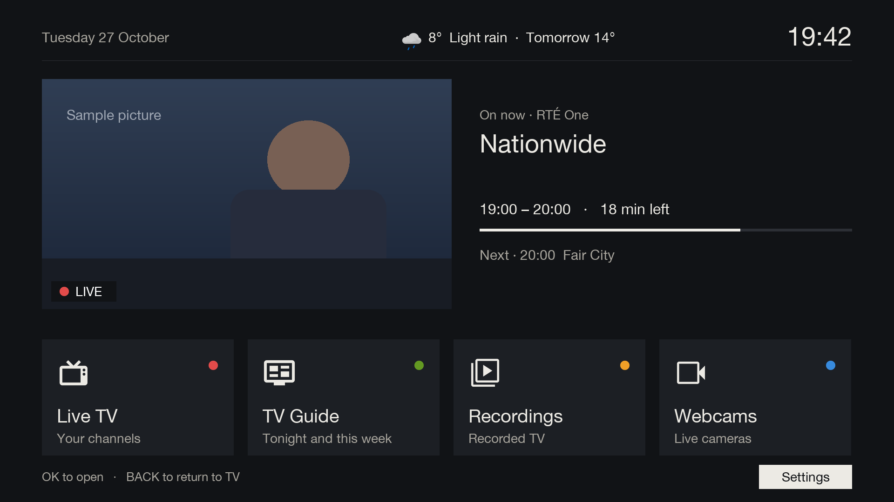

# Home

[Documentation](../README.md) › Home

MENU on the remote opens Home instead of the box's own menu. It is the one place to start from: four large cards,
a live picture of the channel that was on, and the date, time and weather.

The cards are in the same order as the remote's colour buttons, and each colour button opens its card straight away.

| Card | Button | Opens |
|---|---|---|
| Live TV | RED | full-screen TV, back on the channel that was on when Home opened |
| TV Guide | GREEN | the [TV Guide](tv-guide.md) |
| Recordings | YELLOW | the box's [recorded TV programmes](recordings.md) |
| Webcams | BLUE | the [Webcams](webcams.md) grid |

| Key | What it does |
|---|---|
| LEFT / RIGHT | choose a card |
| OK | open the chosen card |
| DOWN | move to Settings |
| BACK or MENU | go back to TV |

## The live preview

The picture on the left is the channel that was on, with a red LIVE marker. Beside it are the programme on now,
how far through it is, and what's on next.

## Weather

The weather line ("8°  Light rain  ·  Tomorrow 14°") comes from Met Éireann, or from Open-Meteo if Met Éireann
can't be reached. It's fetched once an hour in the background, and disappears if neither answers for six hours.
Tech Support sets the house's position; see [Tech Support](../setup/tech-support.md#weather). With no position set,
there's no weather line.

## Settings

Settings, below the cards, is for Tech Support. It asks for the Tech Support PIN and then opens the box's own
menu. The first time it's opened, it asks Tech Support to choose a PIN.

See [Tech Support](../setup/tech-support.md) for the PIN and what it protects.
