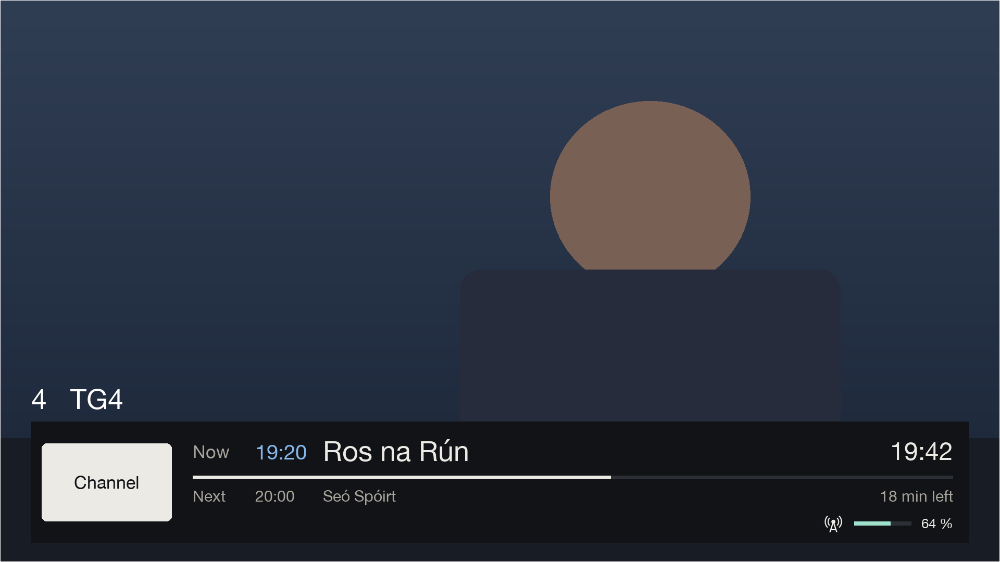
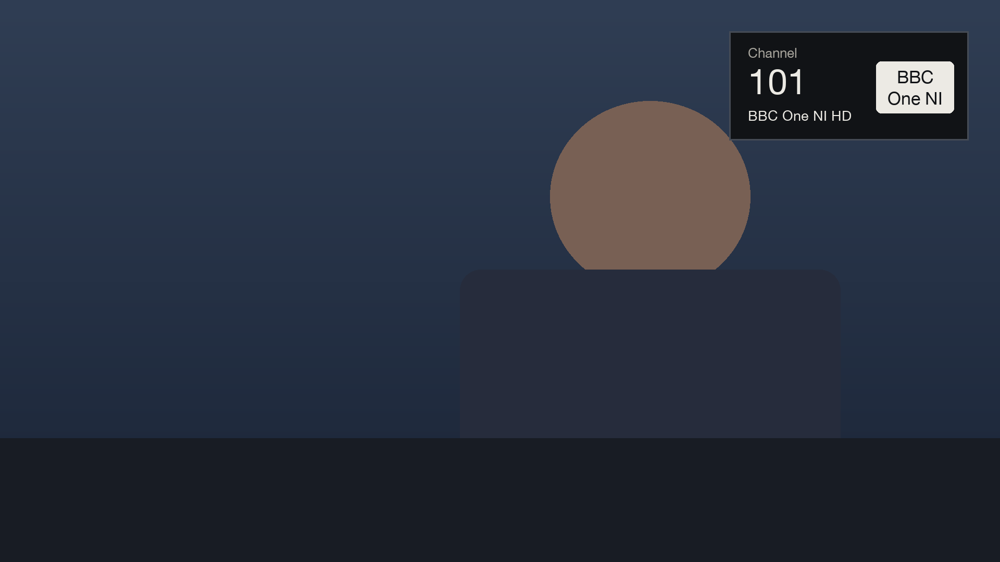
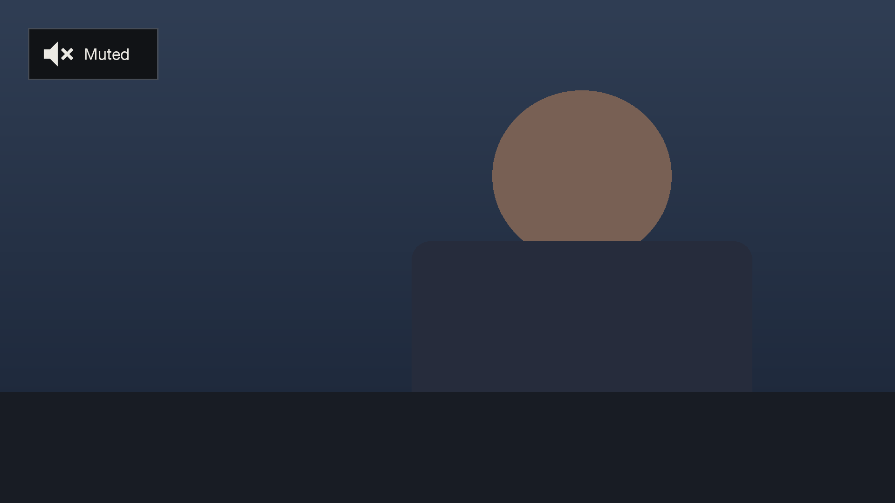
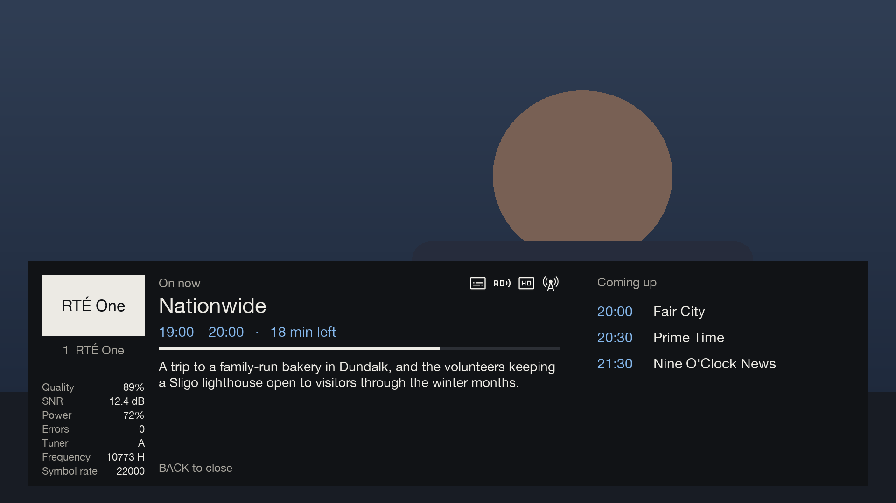
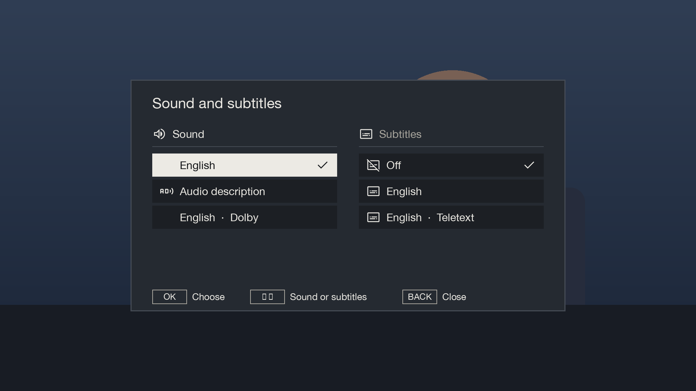

# Live TV

[Documentation](../README.md) › Live TV

While watching TV, Gullion TV replaces the box's own channel banner and pop-ups with larger, plainer ones. The
remote's usual keys still work as before; a few open Gullion TV's screens instead of the box's.

## The channel banner

The banner shows on every channel change and hides after the usual few seconds. OK shows it again.

- The channel number and name sit above the panel in large outlined text, so they show up over any picture.
- The channel's logo (picon) is on the left.
- A large Now line with its start time, the clock, and a bar showing how far through it is.
- Next, with its start time, and how long is left of the programme on now.
- A red REC pill at the start of the right-aligned status group while this channel is being recorded.
- Icons for subtitles, audio description, sign language and repeats (from the listing), HD or 4K (nothing for
  SD), and how the channel arrives: satellite, terrestrial, cable or internet.
- The signal strength as a gauge and a percentage.

Channel numbers match the box's own, including Freesat's (BBC One NI HD is 101).

To go back to the skin's own banner, see [Tech Support](../setup/tech-support.md#settings).

## Typing a channel number

Typing a number on live TV, or in the TV Guide, shows Gullion TV's quick channel selector and goes straight to
that channel. The same selector is used with the standard, channel-name and picon number-entry modes offered by
different OpenATV versions.
When picons are enabled on the box, the number and name stay left-aligned and the selected channel's logo sits
on the right.

The volume pop-up has the same style.

MUTE shows a persistent alert in the top-left corner. It stays visible over every Gullion TV screen until sound
is unmuted, replacing the image's stock mute panel.

## What's on

INFO, or OK twice, shows the programme on now with its full description and the next five on this channel. On the
left are the tuner's details: signal quality, SNR, power, errors, which tuner, and the frequency. They update
every second, which helps when lining up a dish.

INFO, OK or BACK closes it.

## Sound and subtitles

YELLOW, AUDIO or SUBTITLE opens one pop-up for both: the sound tracks on the left (main sound, audio description,
Dolby) and the subtitles on the right (off, DVB, teletext). What's playing has a tick.

| Key | What it does |
|---|---|
| LEFT / RIGHT | sound or subtitles |
| UP / DOWN | choose |
| OK | switch to it straight away |
| BACK or YELLOW | close |

## Recording

| Key | What it does |
|---|---|
| REC | records the programme on now until it ends, with no questions and no "recording started" pop-up. The banner then shows with its REC pill |
| REC again | asks whether to stop recording this channel or keep going |
| STOP | stops this channel's recording straight away |

If the box can't record (no drive, or the drive is full), REC says why instead. Recordings are listed in
[Recordings](recordings.md).

## Keys that open Gullion TV's screens

| Key | Opens |
|---|---|
| MENU | [Home](home.md) |
| GUIDE (EPG), the arrows, TV, FAV | the [TV Guide](tv-guide.md), in place of the box's guide and channel list |
| INFO, or OK twice | What's on |
| YELLOW, AUDIO, SUBTITLE | Sound and subtitles |
