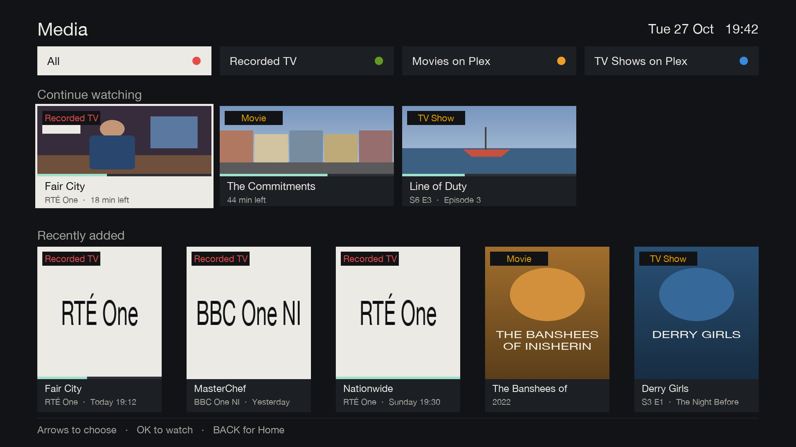
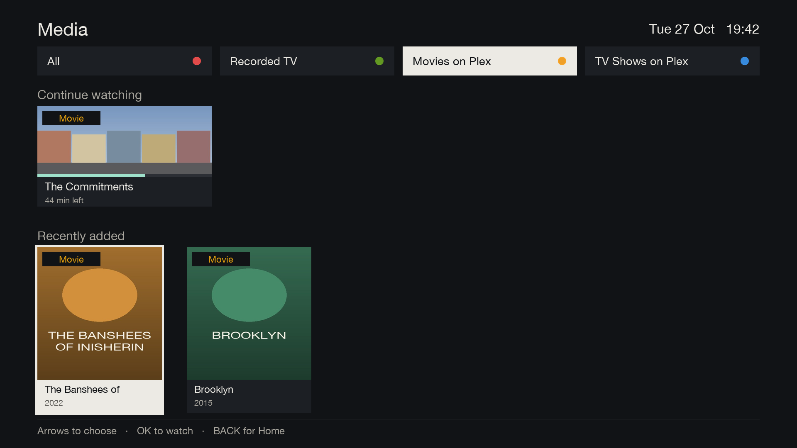
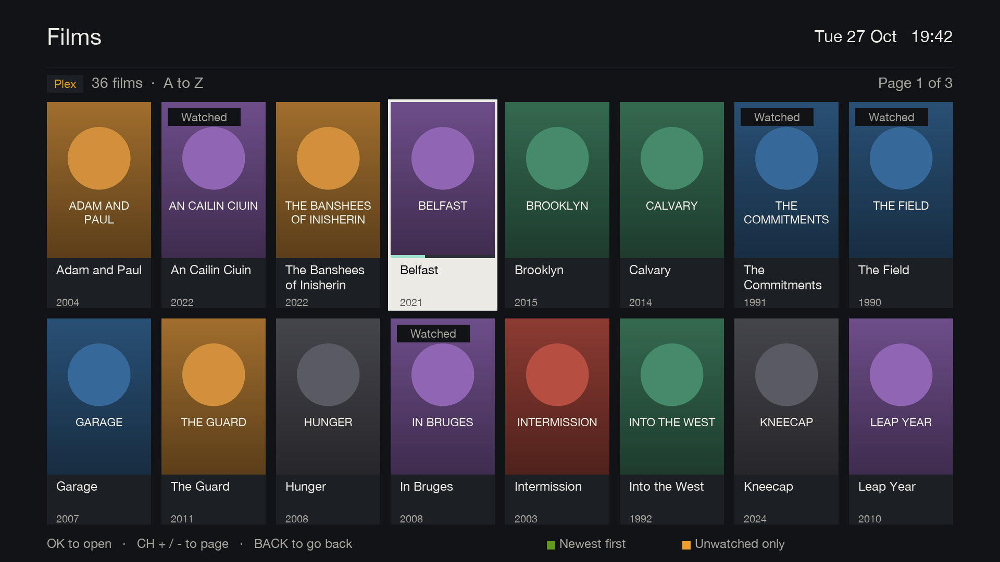
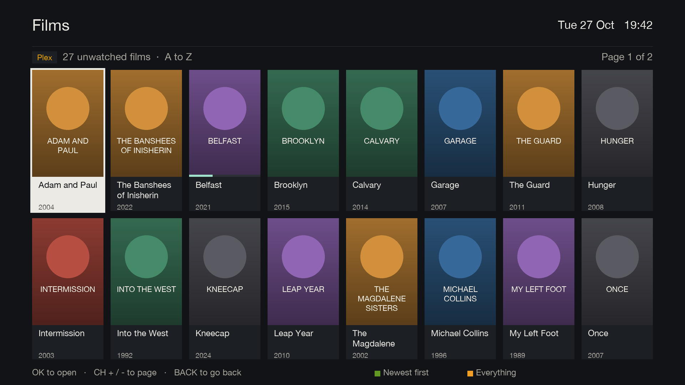
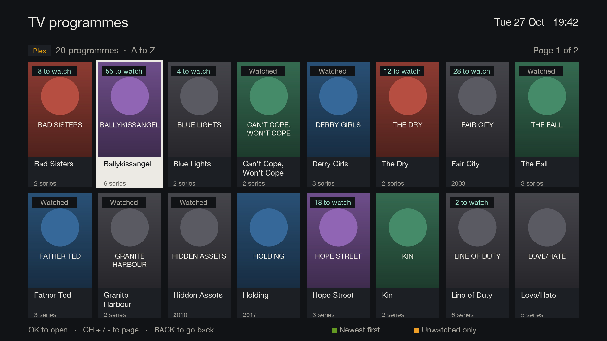

# Plex

[Documentation](../README.md) › Plex

The YELLOW card on Home is called Media. It combines recorded TV with Plex movies and TV shows when Tech Support
has [set up Plex](../setup/plex-setup.md). Without Plex, the same screen still shows recorded TV.

## Media

The four equal tabs across the top are selected directly by the matching remote colour:

| Key | Filter |
|---|---|
| RED | All |
| GREEN | Recorded TV |
| YELLOW | Movies on Plex |
| BLUE | TV Shows on Plex |

Below them are Continue watching and Recently added. Continue watching shows four landscape cards and scrolls
as far as an eighth item. Recently added shows five portrait cards and scrolls as far as a tenth item. All shows
at most three recordings plus one Plex movie and one Plex TV show. The other filters show only their selected type.

Continue watching uses Plex landscape art or a frame from a recording. Recently added uses Plex poster art and
the channel logo for recorded TV. Each panel is labelled Recorded TV, Movie or TV Show.

| Key | What it does |
|---|---|
| LEFT / RIGHT | choose within a row, or change a filter while the tabs are focused |
| UP / DOWN | move between the tabs, Continue watching and Recently added |
| OK | watch, or open |
| MENU | open the full [Recorded TV](recordings.md) list from All or Recorded TV |
| BACK | back to Home |

## Films and TV programmes

Plex posters, 16 a page, with Watched and "8 to watch" badges.

| Key | What it does |
|---|---|
| GREEN | A to Z, or newest first |
| YELLOW | everything, or unwatched only |

Opening a film or programme, and playing from Plex, are still to come.
