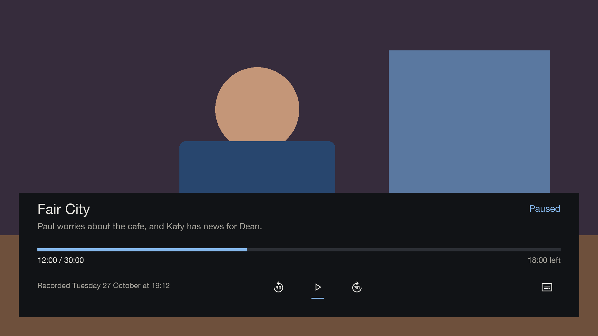
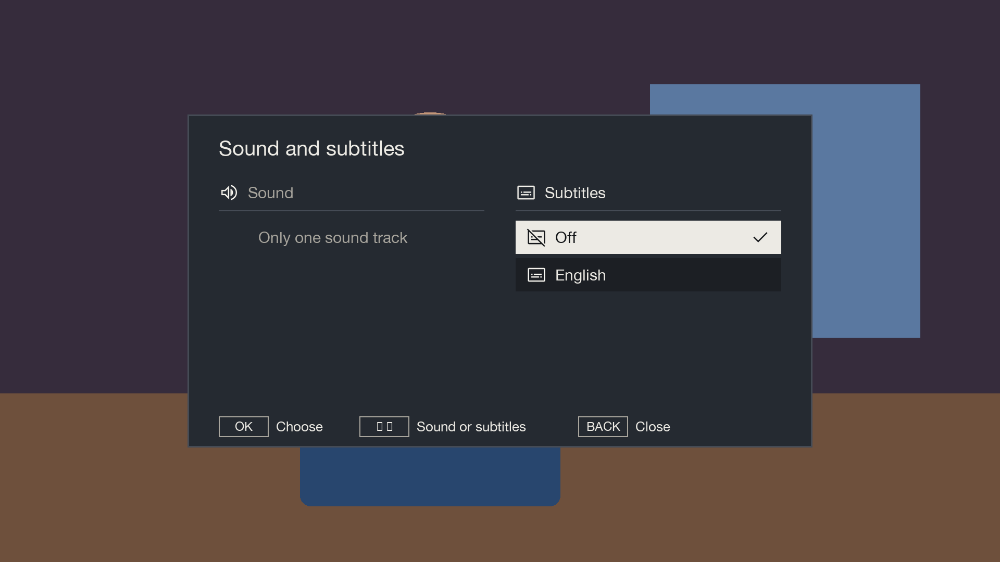
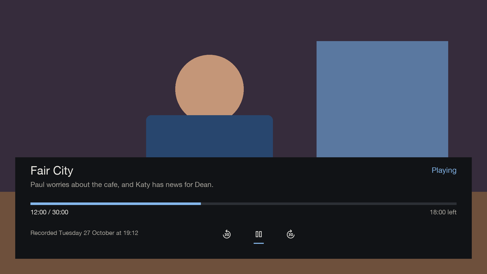

# Recordings

[Documentation](../README.md) › Recordings

The YELLOW Media card on Home opens the [Media screen](plex.md). MENU from its All or Recorded TV filter opens
this full recording list. Live TV stops while the list is open and comes back on the way out.

Each row in the list has:
- a picture from the recording, or the channel's logo until there is one;
- the programme's name;
- the day, time and length, such as "Tue 27 Oct · 20:00 · 30 min"; older recordings also show the year;
- New, Part watched, Watched, or Recording now in red.

A part-watched recording has a thin bar on its picture showing how far it got. The chosen row has an outline.

Beside the list, the chosen recording is shown large:
- its picture, with a red REC pill if it's still being recorded;
- its name and channel, with icons for subtitles, audio description, sign language and repeats;
- "Recorded Tuesday 27 October at 20:00";
- its length and how much room it takes on the drive, such as "30 min · 1.2 GB";
- its description;
- for a part-watched recording, a bar with "12 min watched · 18 min left".

| Key | What it does |
|---|---|
| UP / DOWN | choose a recording |
| LEFT / RIGHT, CH+ / CH- | a page at a time |
| OK | watch it, carrying on from where it was left |
| BLUE | change the order: newest first, oldest first, A to Z, by channel; each order starts at its first recording |
| RED | delete, after a confirmation |
| MENU | more options, including Watch from the start when part watched |
| BACK | back to Home |

## Playing a recording

Playback starts with a control panel over the bottom of the picture. It shows the programme name, its
description, recording date and time, elapsed and total time, time left, and a progress bar. Material Design icons show Pause in the
middle, with closely spaced 30-second rewind and fast-forward icons on either side. A short blue line marks the
selected icon without putting it in a separate box. Pause changes to Play when paused. Subtitles is right aligned
and appears only when the recording contains subtitle tracks.

Use LEFT / RIGHT to highlight an icon and OK to use it. Press UP to select the progress bar, then LEFT / RIGHT
to scrub through the recording one percent at a time; holding either key continues moving. Press DOWN to return
to the controls. UP again while the progress bar is selected hides the panel; DOWN again from the controls does
the same.

The panel hides after six seconds while playing;
OK or INFO brings it back. Pressing OK while it is hidden only shows the controls. Pausing keeps the panel
visible. BACK hides the controls; BACK again while they are hidden finishes playback. STOP always finishes
playback and returns to the recording list or Watch again.

The remote's PAUSE or PLAY/PAUSE key toggles pause, PLAY resumes, and REWIND / FAST FORWARD skip 30 seconds.
Skipping stays within the recording and preserves pause. If seeking is not ready, the panel explains that
skipping is unavailable rather than inventing a new position.

A Subtitles icon appears only when the recorded file reports subtitle tracks. Select it, or press SUBTITLE
or YELLOW, to open Sound and subtitles with the subtitle column selected. Choose a language or Off.
The availability is refreshed during playback, so a track discovered after the file opens appears automatically.

Gullion TV silently continues at the saved stop point instead of showing the stock resume question. The box's
playback engine still saves the stop point. Missing duration or position is shown as `--:--`; the progress bar does not guess a position.
These controls have passed offline checks and renders, but have not yet been tested on a box.

## More options and deleting

Delete asks first, then moves the recording to the box's recycle bin, so Tech Support can bring it back.
Delete is unavailable while the programme is still recording. If recording starts while the confirmation is
open, Gullion TV asks you to wait until it finishes.

Each deleted programme and its companion files stay together in a separate folder in the recycle bin, keeping
older recordings with the same filename safe. The move runs in the background; watching and further deletion
wait until it finishes. You can still browse or leave the list.

If a move fails, Gullion TV tries to put the files back and shows a message if the list is still open. If some
files could not be put back, the message asks Tech Support to restore them from the recycle bin. These folders
have names beginning with `gullion-`; the files inside retain their original names.

## Pictures

With ffmpeg on the box, Gullion TV saves a picture from each recording when it finishes, and catches up on older
ones when Recordings opens. Without ffmpeg, recordings show their channel's logo. See
[Install](../setup/install.md#recording-pictures).

## Watched and New

The box remembers where each recording was stopped, and Gullion TV uses that for Part watched and the watched
bar. A recording with no saved stop point shows as New. The box has no "watched" flag of its own, so a recording
watched elsewhere (for example through OpenWebif) can still show as New.
