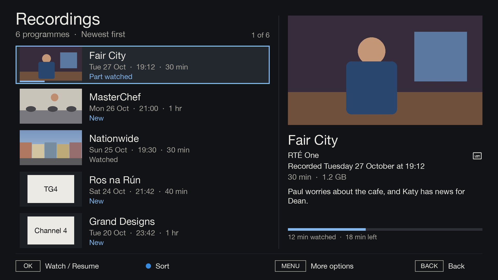
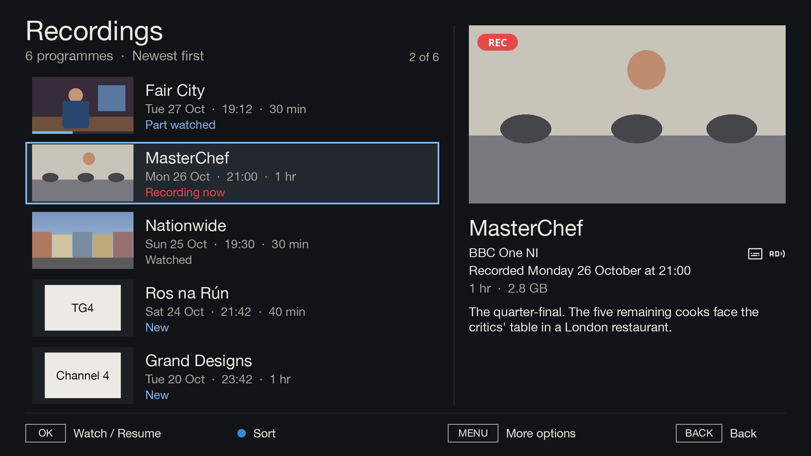
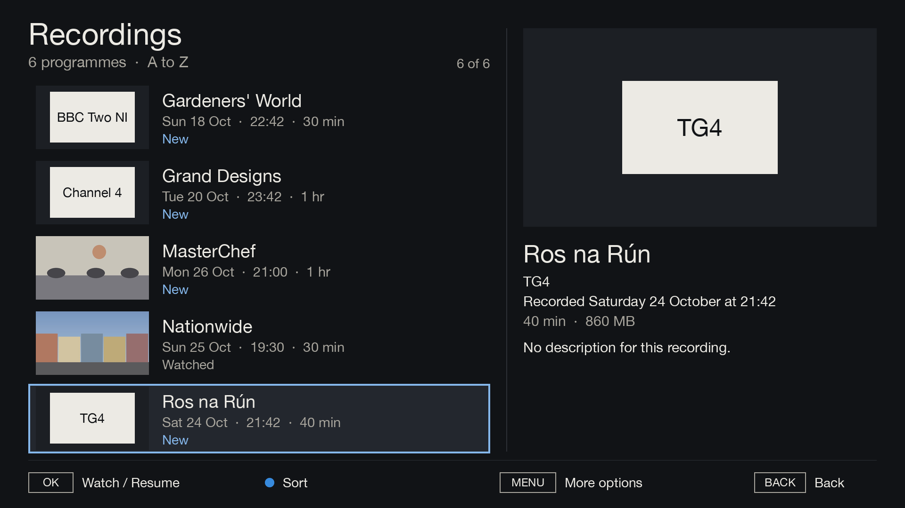
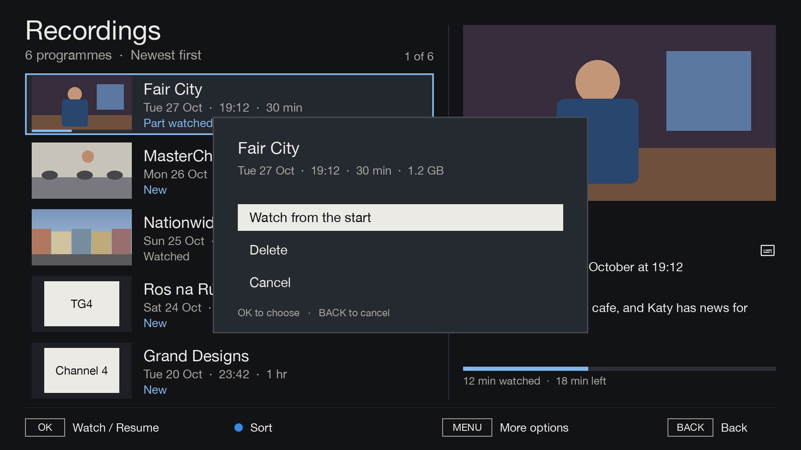
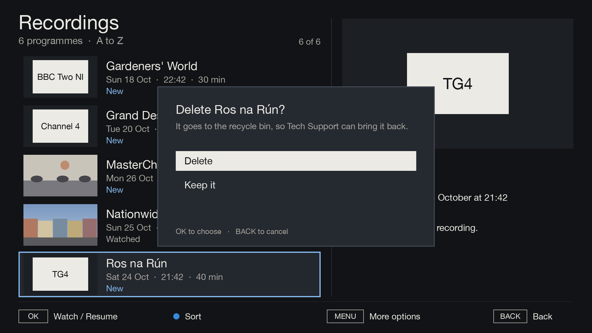

# Recordings

[Documentation](../README.md) › Recordings

The YELLOW card on Home opens the list of recordings. (Once Plex is set up it opens [Watch again](plex.md) first,
where "All recordings" opens this list.) Live TV stops while the list is open and comes back on the way out.

Each row in the list has:
- a picture from the recording, or the channel's logo until there is one;
- the programme's name;
- the day, time and length, such as "Tue 27 Oct · 20:00 · 30 min";
- New, Part watched, Watched, or Recording now in red.

A part-watched recording has a thin bar on its picture showing how far it got. The chosen row has an outline.

Beside the list, the chosen recording is shown large:
- its picture, with a red REC pill if it's still being recorded;
- its name and channel, with icons for subtitles, audio description, sign language and repeats;
- "Recorded Tuesday 27 October at 20:00";
- its length and how much room it takes on the drive, such as "30 min · 1.2 GB";
- its description;
- for a part-watched recording, a bar with "12 min watched · 18 min left".

| Key | What it does |
|---|---|
| UP / DOWN | choose a recording |
| LEFT / RIGHT, CH+ / CH- | a page at a time |
| OK | watch it, carrying on from where it was left |
| BLUE | change the order: newest first, oldest first, A to Z, by channel |
| MENU | more options: Watch from the start (if part watched), Delete |
| BACK | back to Home |

## More options and deleting

Delete asks first, then moves the recording to the box's recycle bin, so Tech Support can bring it back.

## Pictures

With ffmpeg on the box, Gullion TV saves a picture from each recording when it finishes, and catches up on older
ones when Recordings opens. Without ffmpeg, recordings show their channel's logo. See
[Install](../setup/install.md#recording-pictures).

## Watched and New

The box remembers where each recording was stopped, and Gullion TV uses that for Part watched and the watched
bar. A recording with no saved stop point shows as New. The box has no "watched" flag of its own, so a recording
watched elsewhere (for example through OpenWebif) can still show as New.
