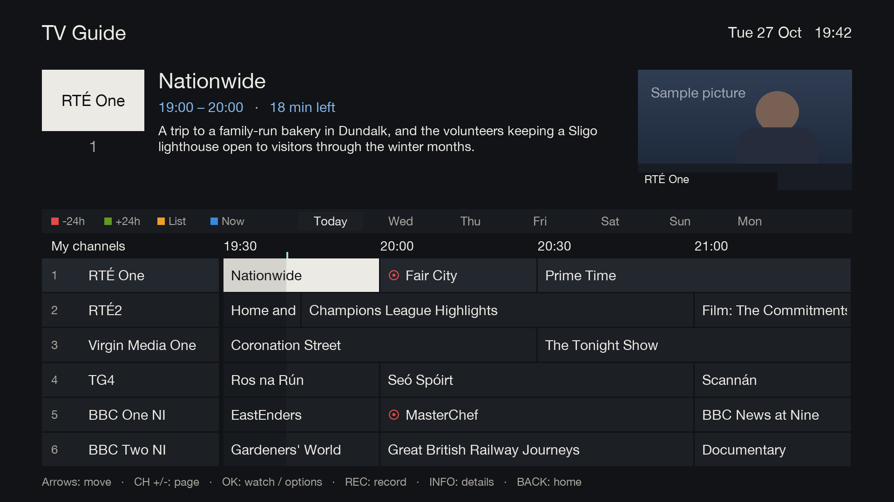
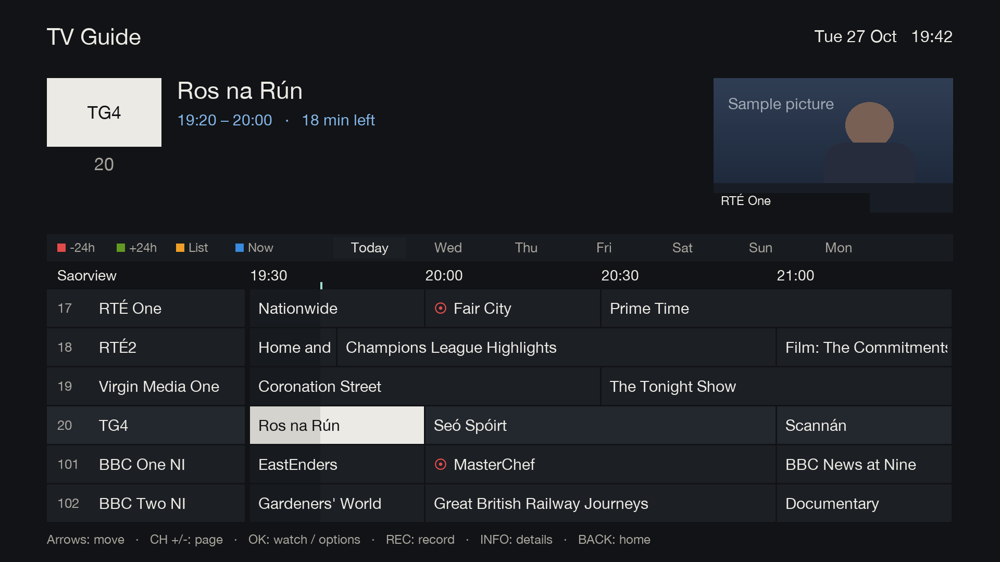
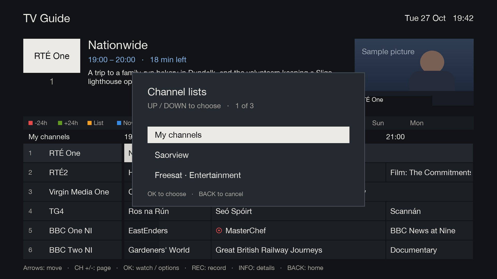
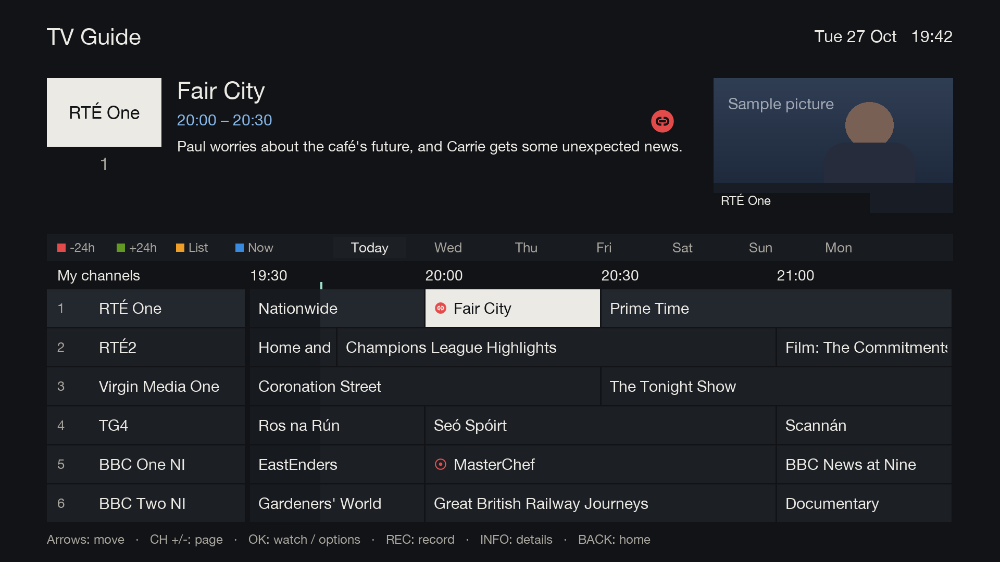
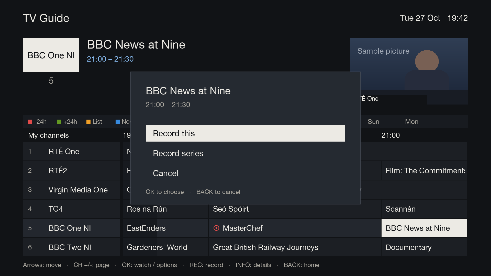
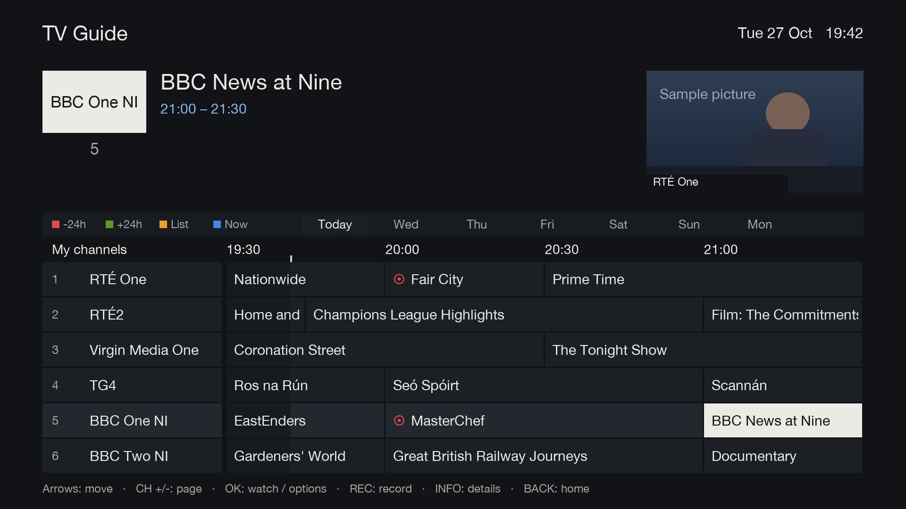
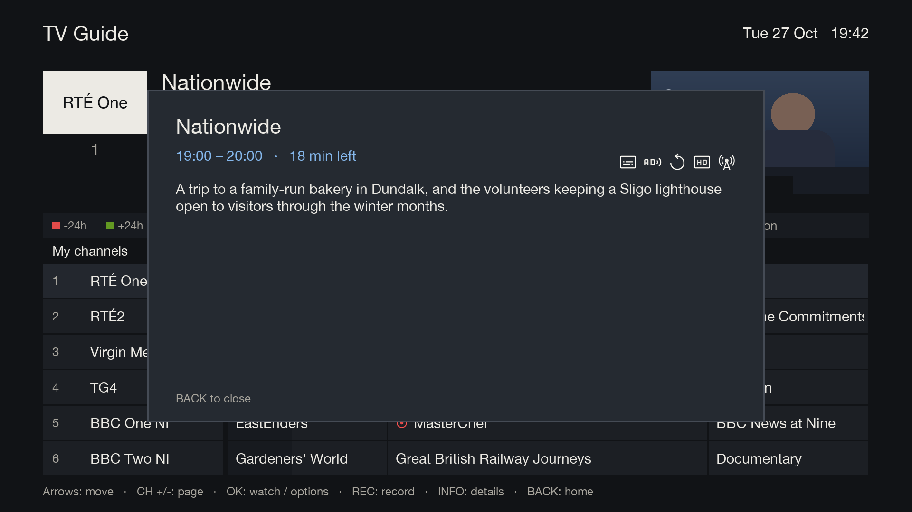
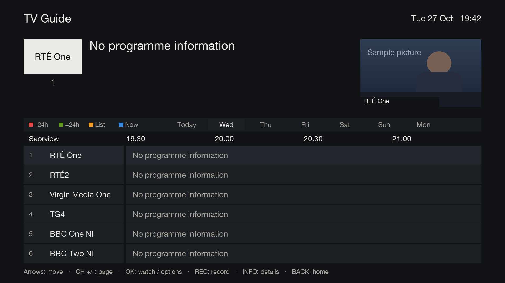
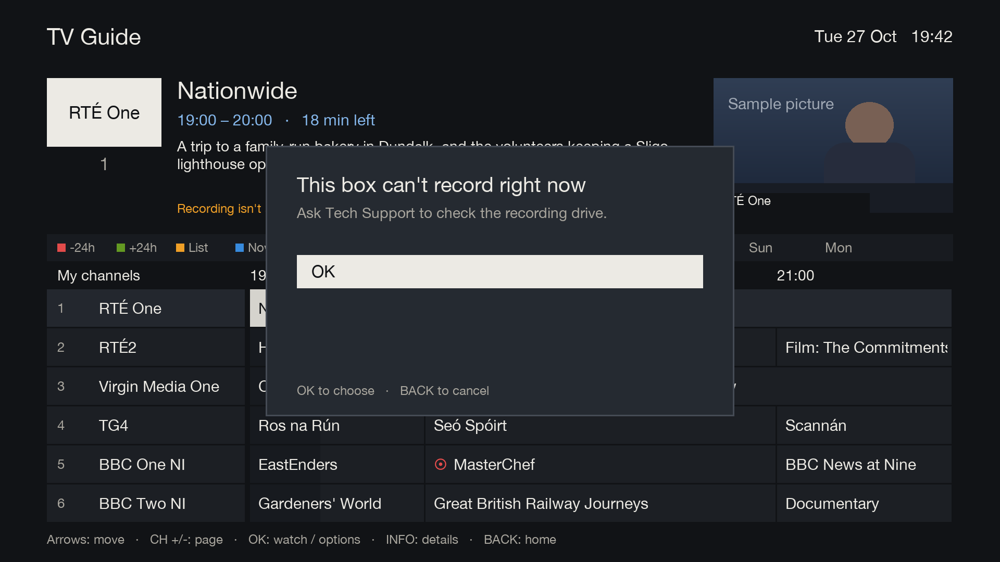

# TV Guide

[Documentation](../README.md) › TV Guide

The TV Guide is a two-hour grid of six channels at a time. The chosen channel's logo, the chosen programme's
details and the live picture are along the top.

| Key | What it does |
|---|---|
| UP / DOWN | choose a channel |
| LEFT / RIGHT | choose a programme |
| CH+ / CH- | a page of channels at a time |
| RED / GREEN | a day back / a day forward |
| YELLOW | choose an enabled channel list (for example Saorview or Freesat) |
| BLUE | back to now |
| OK | watch a programme that's on now, or record a later one |
| REC | record the chosen programme |
| INFO | the programme's full details |
| 0-9 | type a channel number to jump to it |
| BACK | back to Home or TV |

Channels scroll continuously through the enabled lists in the box's order, keeping their channel numbers.
For example, DOWN after Saorview channel 20 goes straight to Freesat channel 101; UP goes back to 20.
CH+ / CH- also cross list boundaries. The list name above the channel column follows the selected channel.

YELLOW opens a selector with the current list highlighted. UP / DOWN move through the enabled, non-empty lists
(three choices per page), OK jumps to the first channel in that list, and BACK keeps the current channel.
Selecting a list does not filter out the others: scrolling still continues into the next list.

GUIDE, the arrows, TV and FAV open this guide from live TV, in place of the box's own guide and channel list.

## Recording from the guide

A programme that's set to record has a red outlined recording circle in the grid. Recordings made by an
AutoTimer series rule use the red linked-circle mark. The same appropriate icon appears in the top details for
a future recording; the REC pill is reserved for a programme that is actually recording now. OK on a later programme offers
**Record this**, and also **Record series** when AutoTimer is installed on the box. A series rule matches the
title exactly, including capital letters, and records only from the selected channel using the box's normal
recording margins. On a programme already set to record, OK offers to cancel. Programmes that have finished
can't be recorded, so OK and REC do nothing on them.

The live position is visible both as the mint marker under the time ruler and as a subtle change of background
within every programme currently on. The portion to the left has elapsed; the portion to the right remains.

## Programme details

INFO shows the chosen programme's full description. Codes broadcasters add to the end of a description, such as
"(HD, S, AD)" on Saorview or "[S,AD] [HD]" on Freesat, are removed using the same parser as What's on.
Subtitles, audio description (A or AD), sign language and repeats appear as icons. The full details panel also
shows HD and the delivery type from the selected channel, rather than the channel in the live preview.
Ordinary bracketed text such as "(USA)" stays in the description.

The bottom line contains the remote-key hints; the repeated outlined OK, REC and INFO keys above the timeline
have been removed.

## Other days and lists

## When the box can't record

Each time it opens, the guide checks the recording drive: plugged in, writable, and at least 2 GB free. If the
box can't record, the REC hint and record options go, and REC explains why. Under 10 GB free, it warns that space
is low.

