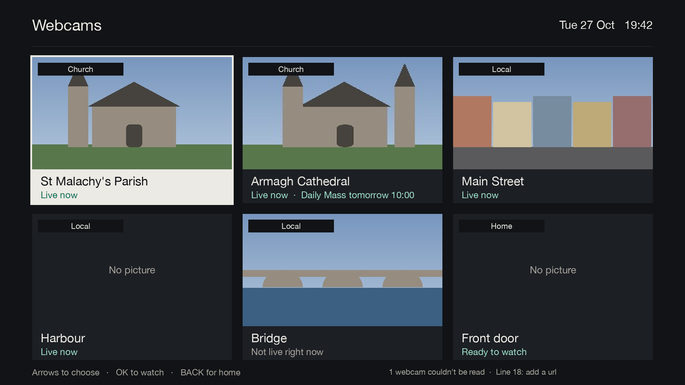
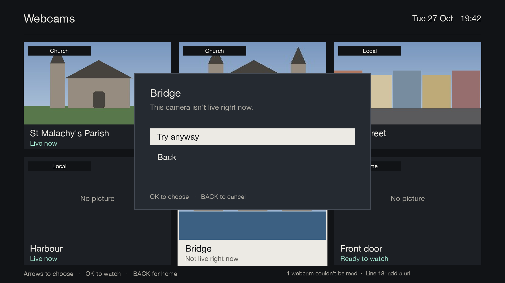
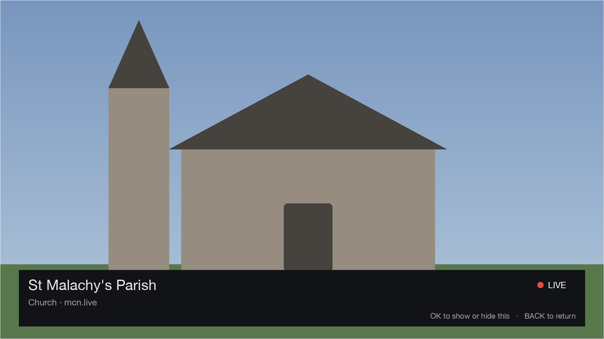
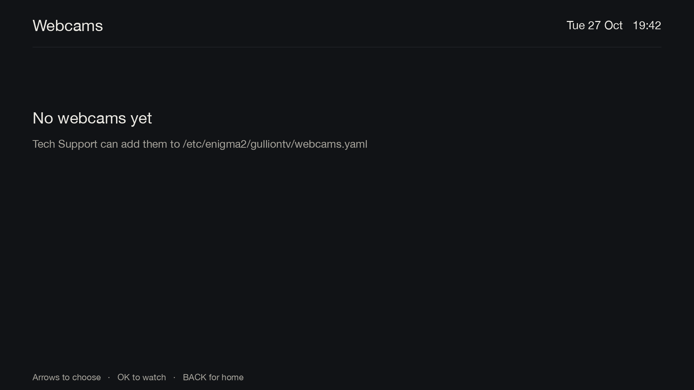

# Webcams

[Documentation](../README.md) › Webcams

The BLUE card on Home shows a tile for each camera or church service in the box's webcams list. Each tile has a
picture, the camera's name and whether it's live. For a churchservices.tv church, it also shows when the next
service is. Pages are checked in the background, so the grid shows straight away and fills in.

| Key | What it does |
|---|---|
| Arrows | choose a camera |
| OK | play it full screen |
| BACK | back to Home (from a playing camera: back to the grid, with the channel that was on) |

A camera that isn't live asks before trying.

Playing full screen, the camera shows a red LIVE marker with its name.

If the list is empty or missing, Webcams says so.

To add or change cameras, see [Webcams list](../setup/webcams-config.md).
