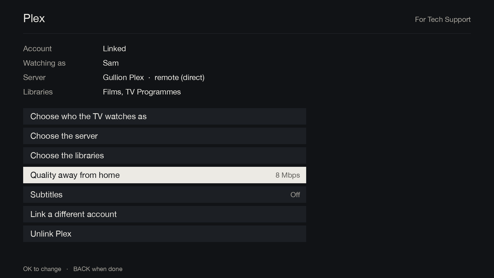
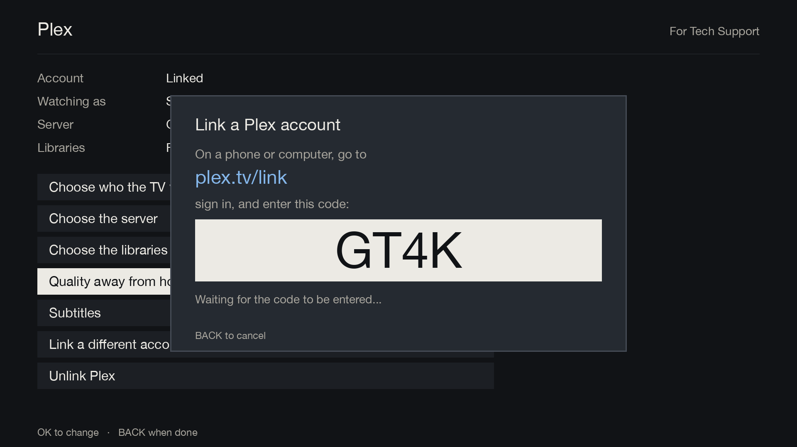
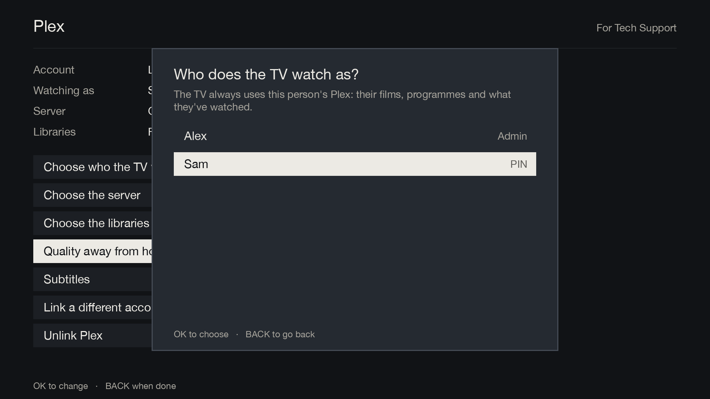
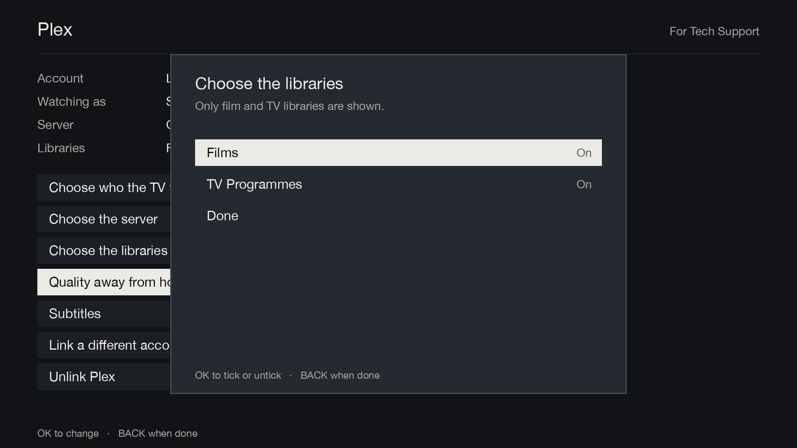

# Plex setup

[Documentation](../README.md) › Plex setup

Plex setup is in Menu → Plugins → Gullion TV → BLUE (Plex), behind the Tech Support PIN.

1. **Link a Plex account.** The TV shows a code; enter it at plex.tv/link on a phone or computer.

   

2. **Who the TV watches as.** Pick the Plex Home user, and their PIN if they have one. The TV always uses this
   person's Plex: their films, programmes and what they've watched.

   

3. **The server.** Pick it, and Gullion TV finds the best way to reach it: the last way that worked, then the
   local network, then the internet, and Plex's relay only as a last resort. Setup shows which it's using.

4. **The libraries.** Only film and TV libraries are offered; all are ticked to start.

   

Then "Quality away from home" (8 Mbps to start) and subtitles (off) can be changed.

Everything is saved in `/etc/enigma2/gulliontv/plex.json`, readable only by root because it holds the Plex
tokens. Streaming from a server outside the home needs Plex Pass on the server owner's account, or a Remote Watch
Pass for the viewer.

Once it's set up, see [Plex](../features/plex.md) for what changes on Home.
