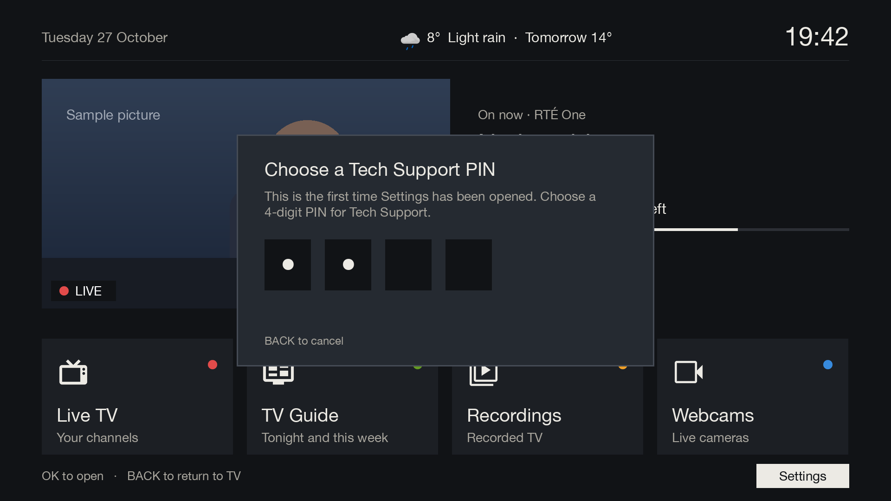

# Tech Support

[Documentation](../README.md) › Tech Support

Gullion TV keeps the box's own menus out of the way behind a Tech Support PIN, so they can't be changed by accident.

## The PIN

There's no default PIN. The first time Settings on [Home](../features/home.md) is opened, Gullion TV asks for a
4-digit Tech Support PIN, twice, and won't take an easy one like 0000 or 1234.

After that, Settings asks for it each time.

### What it locks

The PIN guards every way into the box's own settings and plugins, not just Settings on Home:
- the box's main menu and its setup screens;
- GREEN's plugin list, and downloading or removing plugins;
- BLUE's extensions list;
- the channel list's edit menu;
- anything set up in Button setup, and the quick menu.

## Settings

Menu → Plugins → Gullion TV (behind the PIN):

| Setting | What it does |
|---|---|
| Open Gullion TV with MENU | Yes: MENU opens Home. No: MENU opens the box's own menu, with no PIN |
| Large channel banner (after restart) | Yes: Gullion TV's [channel banner](../features/live-tv.md#the-channel-banner). No: the skin's own. Takes effect after a restart |
| Tech Support PIN | change the PIN |
| Weather location (latitude, longitude) | where the weather on Home is for; see [below](#weather) |

BLUE on this screen opens [Plex setup](plex-setup.md).

To turn Gullion TV off, set "Open Gullion TV with MENU" to No. To turn it back on, go to Menu → Plugins → Gullion
TV and set it to Yes again.

## Weather

Enter the house's position as **Weather location**, for example `54.0830, -6.4500`. In Google Maps, right-click
the house to copy it. Leave it empty for no weather line.

The forecast comes from Met Éireann, or from Open-Meteo if Met Éireann can't be reached, and is fetched once an
hour in the background. If neither answers for six hours, the weather line disappears until one does.
